# 프로젝트 개요

상업용 실시간 2인 대전 보드게임 서버입니다. 지금 들어 있는 게임은 **가위바위보(RPS)**, **오델로**, **점핑(stepping)**, **에어하키(airhockey)** 네 가지와, 혼자 하는 **청기백기(flag)** 하나입니다.
Colyseus 위에서 도는 Node.js/TypeScript 서버이고, 이 파일은 Claude Code 가 매 세션 읽는 **현재 기준 설계서**입니다.

> 📦 2026-10-13 이전의 상세한 변경 경위는 `docs/archive/CLAUDE_2026-10-13.md` 에 원본 그대로 있습니다.
> 이 문서에는 **최종 동작**과 **다시 밟을 수 있는 함정(⚠️)** 만 남겼습니다.

---

## 1. 기술 스택

| 항목 | 내용 |
|---|---|
| 런타임 / 언어 | Node.js 24, TypeScript 7, **ESM**(`"type": "module"`, 상대 import 는 `.js` 확장자) |
| 프레임워크 | `@colyseus/core` 0.18.15 + `@colyseus/ws-transport` 0.18.2 (통합 패키지 `colyseus` 미사용). `express` 는 ws-transport 가 내부에서 써서 설치만 함 |
| 클러스터 | `@colyseus/redis-presence` + `@colyseus/redis-driver` — **모든 채널이 같은 Redis(6780)** 를 공유. 로비가 다른 프로세스(게임 채널)의 방에 좌석을 예약할 수 있는 이유 |
| DB | MySQL(`mysql2`), 개발 PC 는 XAMPP MariaDB 10.4 |
| 캐시 | Redis 6780(`ioredis`) — ⚠️ `import { Redis } from "ioredis"` **named import** 만 됨 |
| 통신 | **모든 통신은 소켓 + JSON**. HTTP API 없음(Colyseus 내부 `POST /matchmake/...` 만 예외) |
| 암호화 | 모든 채널 wss(TLS). 인증서 경로는 `.env`, 개발 환경에서만 ws 허용 |
| 빌드 | `npm run build` = `tsc` + `scripts/copy-assets.mjs`(`schema.sql` 등 정적 파일 복사) |

---

## 2. 전체 구조

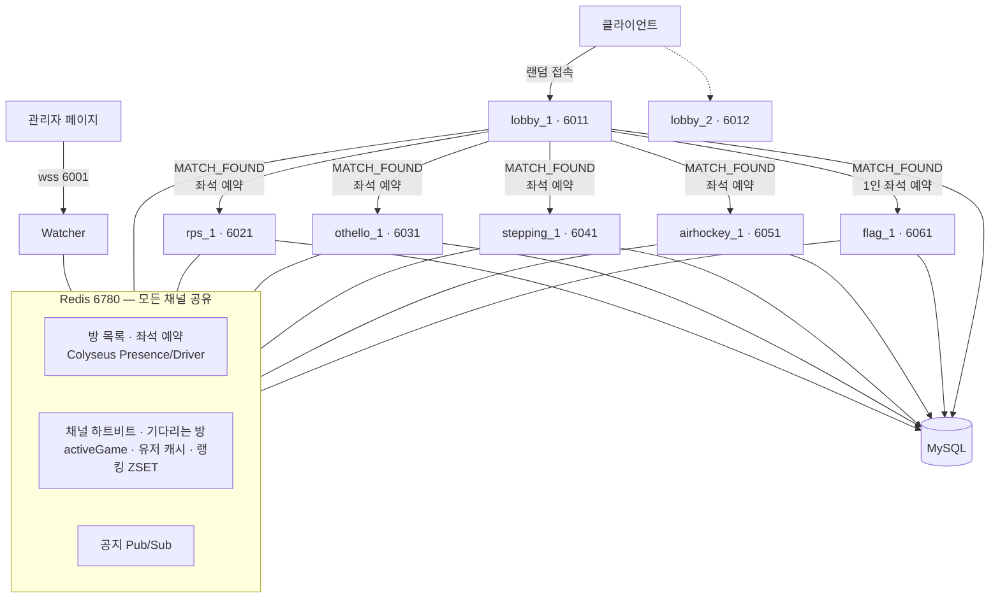

### 채널 / 포트

**채널 = 소켓 = 프로세스 하나 = 포트 하나**입니다. 채널 번호는 1부터 셉니다(`lobby_1` = 채널 ID `lobby-1`).

| 채널 | 룸 이름 | 포트 | 개수 (운영 목표 / **지금 개발**) |
|---|---|---|---|
| Watcher | - | 6001 | 1 / 1 |
| 로비 | `lobby_N` | 6011, 6012 | 2 / **1** |
| 가위바위보 | `rps_N` | 6021~6023 | 3 / **1** |
| 오델로 | `othello_N` | 6031~6033 | 3 / **1** |
| 점핑 | `stepping_N` | 6041~6043 | 3 / **1** |
| 에어하키 | `airhockey_N` | 6051~6053 | 3 / **1** |
| 청기백기 (1인) | `flag_N` | 6061~6063 | 3 / **1** |

- ⚠️ **Watcher 가 6000 이 아닌 이유**: 6000 은 브라우저 fetch 의 금지 포트(`ERR_UNSAFE_PORT`)라 관리자 페이지가 접속할 수 없습니다.
- 게임 채널 수는 코드 상수(`RPS_CHANNEL_COUNT`, `OTHELLO_CHANNEL_COUNT`, `STEPPING_CHANNEL_COUNT`, `AIRHOCKEY_CHANNEL_COUNT`, `FLAG_CHANNEL_COUNT` = 1)로 묶여 있습니다. 늘리려면 상수를 올리고 재빌드한 뒤 로비도 재시작해야 합니다.
- 로비 채널 수는 `.env` 의 `LOBBY_PORTS` 목록 길이로 정해집니다. 코드는 고치지 않고 `node dist/index.js lobby 3` 처럼 띄우기만 하면 됩니다. 다만 클라이언트가 새 포트를 알아야 실제로 유저가 들어옵니다.

### 규모 스펙

| 항목 | 값 |
|---|---|
| 채널당 최대 동시 접속 | 300명 (넘으면 `ENTER_LOBBY{error:4}`) |
| 게임 채널당 방 / 인원 | 100방 / 200명 (방당 2명) |
| 게임 채널 배정 | **번호가 빠른 채널부터** 채우고 차면 다음 채널 |
| 전부 찼을 때 | `ERROR{NO_GAME_ROOM}` — "접속 가능한 게임방이 없습니다. 잠시 후 다시 참여 해 주세요." 유저는 로비에 남음 |

---

## 3. 실행 방법

```powershell
npm run redis            # ① Redis 먼저 (종료는 redis-cli -p 6780 SHUTDOWN SAVE)
npm run build            # ② 코드가 바뀔 때마다
npm run pm2:start:dev    # ③ watcher + lobby_1 + rps_1 + othello_1 + stepping_1 + airhockey_1 + flag_1 (지금 개발 정책)
```

| 명령 | 용도 |
|---|---|
| `npm run start:lobby1` / `start:rps1` / `start:othello1` / `start:stepping1` / `start:airhockey1` / `start:flag1` | 채널 하나만 터미널에서 실행 |
| `npm run pm2:start` | 운영 규모 전체 (게임 채널 상수를 먼저 올려야 함) |
| `npm run pm2:status` / `pm2:logs` / `pm2:stop` / `pm2:restart` | 상태 / 로그 / graceful 정지 / 재시작 |
| `npm run db:init` | DB 생성 + 스키마 + 이번 달 로그 테이블 (여러 번 실행해도 안전) |
| `npm test` | 단위 테스트 (205개) |

- PM2 설정은 `ecosystem.config.cjs` 입니다. PM2 가 `require()` 로 읽기 때문에 `.cjs` 여야 합니다.
- `kill_timeout` 은 **12분**입니다. 게임 채널의 드레인(최대 10분)보다 짧으면 무중단 재시작이 무의미해집니다.
- ⚠️ **Windows 에서는 PM2 로만 SIGINT 가 전달됩니다.** `taskkill`/`kill -SIGINT` 로는 graceful shutdown 이 돌지 않습니다.
- ⚠️ `taskkill /F` 를 반복하면 Redis 방 레지스트리에 유령 방이 남습니다. 가능하면 `pm2 stop` 이나 Ctrl+C 를 쓰세요.
- ⚠️ `EADDRINUSE`: `netstat -ano | findstr 6021` 로 PID 를 찾고, **죽이기 전에 의도적으로 띄운 서버인지 확인**하세요. 옛 빌드로 떠 있는 좀비가 "고친 코드가 반영 안 된 것처럼" 보이게 만든 적이 있습니다. Git Bash 에서는 `taskkill //PID <PID> //T //F` 처럼 씁니다.
- `pm2 install` 시 나오는 `npm audit` high 경고는 안 쓰는 `pm2 deploy` 의존성이라 보류했습니다.

---

## 4. 폴더 구조

```
src/
  index.ts                  진입점 — node dist/index.js <watcher|lobby|rps|othello|stepping|airhockey|flag> <번호>
  common/                   플랫폼 공용
    config.ts               .env 로딩            constants.ts   플랫폼 상수
    channelNames.ts         룸 이름/포트 규칙, GameType, ALL_GAME_TYPES, IsGameType
    types.ts                메시지 타입·envelope·ReadPayload (프로토콜 단일 기준)
    messages.ts             SendMessage / SendError / SendResult
    log.ts                  C↔S 로그 (phone 마스킹, 비밀·통계 payload 생략)
    roomRegistry.ts         이 프로세스의 Room 목록 (공지·접속자 리포트·드레인)
    userid.ts / nameFilter.ts
  watch/                    WatcherRoom / WatcherManager — 관리자 채널
  game/
    lobby/                  LobbyRoom / LobbyManager — 입장·별명·통계·랭킹·매칭·REJOIN_GAME
    room/                   게임 종류를 모르는 매칭 코드
      GameRoomMatcher.ts    채널 선택 + 방 생성 + 좌석 예약 (게임별 인스턴스)
      waitingRooms.ts       "기다리는 방" 큐 (Redis LIST, 게임별 키)
      activeGame.ts         userid → 게임 중인 방 (F5 재접속용)
    rps/                    RpsGameRoom · rpsRules(순수 함수) · rpsTypes · rpsConstants
    othello/                OthelloGameRoom · othelloRules(순수 함수) · othelloTypes · othelloConstants
    stepping/               SteppingGameRoom · steppingRules(순수 함수) · steppingTypes · steppingConstants
    airhockey/              AirhockeyGameRoom · airhockeyRules(물리·봇, 순수 함수) · airhockeyTypes · airhockeyConstants
    flag/                   FlagGameRoom(1인) · flagRules(문제·판정, 순수 함수) · flagTypes · flagConstants
  db/
    connection.ts / redis.ts / initDb.ts / schema.sql
    userRepository.ts       유저 조회의 유일한 입구 (Redis → DB → 신규 등록)
    userCache.ts            user:info:{userid} (TTL 120초, phone 없음)
    playInfoRepository.ts   게임별 통계 user:play:{game}:{userid}
    {rps,othello,stepping,airhockey,flag}GameResultRepository.ts / {…}GameLogSchema.ts
    rankingRepository.ts / rankingZSet.ts
    channelHeartbeat.ts     채널 생존 + 담당 processId + 닫는 중 표시
    channelUsers.ts / noticePubSub.ts
    queries/                테이블별 SQL (userInfo, userPlayInfo, userRegistration, {rps,othello,stepping,airhockey,flag}GameLog, ranking …)
scripts/
  colyseus-test-client.mjs  검증용 최소 Colyseus 클라이언트 (SDK 없이 matchmake → WS → msgpack)
  check-*.mjs               실서버 검증 스크립트 (아래 10장)
```

---

## 5. 유저 흐름

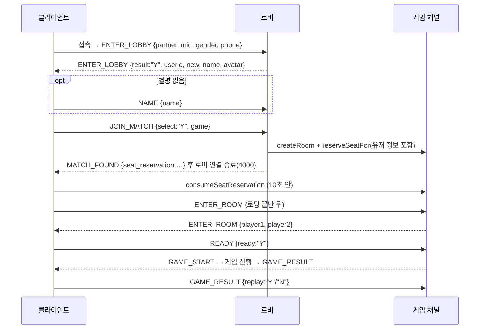

### userid

- `userid = partner + "_" + XOR(mid)` 입니다. 글자마다 `문자코드 ^ 5` 를 해서 10진수로 이어 붙입니다(`'u'`(117) → `"112"`).
- 형식: partner 영숫자 1~11자(`_` 금지), mid 영숫자 1~63자, userid 최대 201자(DB `VARCHAR(255)`).
- ⚠️ **암호화가 아닙니다.** userid 에서 mid 를 되돌릴 수 있으니 비밀로 취급하지 마세요. 구현은 `common/userid.ts` 입니다.

### 유저 정보 — 하이브리드 방식

| 시점 | 동작 |
|---|---|
| 로비 입장 | Redis `user:info` → 없으면 DB → 없으면 신규 등록(트랜잭션, **모든 게임 통계 행 포함**) → Redis 저장 |
| 로비 → 게임방 | **좌석 예약에 유저 정보를 담아** 전달. 게임방은 Redis/DB 를 조회하지 않음(실측 SELECT 0회) |
| 매칭 직전 | `GameRoomMatcher` 가 **그 게임의 통계**(`user:play:{game}`)로 `UserInfo` 를 덮어씀 |
| 게임 결과 | DB 반영 직후 Redis 도 갱신(write-through) |
| 로비/게임방을 떠날 때 | 값은 쓰지 않고 **TTL(120초)만** 다시 설정 |

- **phone 은 개인정보**입니다. 좌석 예약, 로그, Redis 캐시, 다른 유저에게 절대 넣지 않습니다.
  - DB 조회용 `DbUserInfo` 에만 phone 이 있고, 캐시용 `UserInfo` 에는 없습니다.
  - 기존 유저가 다른 phone 을 보내면 갱신합니다. 단, 캐시가 미스일 때만 비교합니다(사용자 결정).
- 같은 userid 가 이 로비에 이미 있으면 `ENTER_LOBBY{error:2}` 로 응답합니다. 그 userid 가 **게임 중**이면 대신 `REJOIN_GAME` 을 보냅니다.

---

## 6. 게임 규칙

### 6-1. 공통 (모든 게임)

| 항목 | 규칙 |
|---|---|
| 입장 | 양쪽 다 `ENTER_ROOM` → 응답 → 양쪽 다 `READY:"Y"` → `GAME_START` |
| 좌석 예약 | 10초 안에 안 들어오면 먼저 온 유저는 `RETURN_TO_LOBBY` |
| 재게임 | 10초 무응답 = 나가기. `N` 은 상대를 기다리지 않고 **그 유저만 즉시** 로비로 |

| A | B | 처리 |
|---|---|---|
| 재게임 | 재게임 | 같은 방에서 `GAME_START` 부터 다시 (READY 생략) |
| 재게임 | 나가기 | B 는 로비로. A 는 **"기다리는 방"** 에 등록되어 새 상대를 기다림(시간 제한 없음) → 새 상대가 오면 `OPPONENT_JOINED`, 그 뒤 둘 다 `ENTER_ROOM` 부터 |
| 나가기 | 나가기 | 둘 다 로비, 방 정리 |

- 로비 매칭은 **"기다리는 방"을 새 방보다 먼저** 채웁니다(Redis LIST `waiting_rooms:{game}`, LPOP 이라 원자적).
- 결과 DB 저장은 응답을 늦추지 않도록 fire-and-forget 으로 하고, 에러만 로그에 남깁니다.

### 6-2. 가위바위보

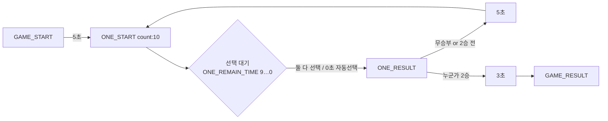

| 항목 | 값 |
|---|---|
| 승리 조건 | **2선승** (무승부는 판 수에 넣지 않고 다시) |
| 선택 제한 | 10초, 넘으면 서버가 랜덤 선택 |
| 마지막 판 연출 | 마지막 `ONE_RESULT` 뒤 **3초** 후 `GAME_RESULT`(`RPS_LAST_RESULT_DELAY_SEC`). 그동안은 아직 게임 중으로 취급. 둘 다 나가면 기다리지 않음 |
| 점수 | 2:0 승리 **20점**, 2:1 승리 **10점**, 패자 0점 (승-무-승도 2:0) |
| 봇/자동 진행 | 점수를 원래 유저에게 그대로 반영 |

### 6-3. 오델로

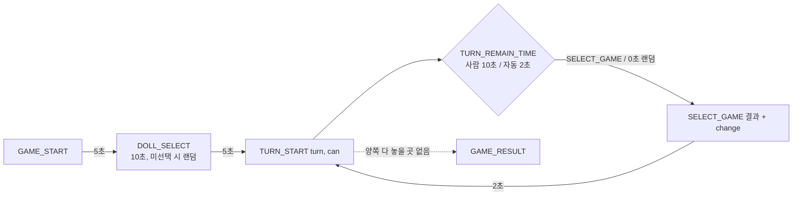

| 항목 | 값 |
|---|---|
| 보드 | 8×8, 좌표 **0~7**(0-based), **검정(1) 선공**, 흰색=0 |
| 돌 선택 | 한쪽이 고르면 상대는 자동으로 반대 색 |
| 패스 | 별도 메시지 없음 — 같은 `turn` 이 연속으로 오면 상대가 패스한 것 |
| 종료 | 양쪽 모두 놓을 곳이 없을 때. 돌이 많은 쪽이 승리, 같으면 `draw:"Y"` |
| 점수 | 승리 **20점**, 패배·무승부 0점 |

### 6-3-1. 점핑 (stepping)

두 유저가 **같은 맵**에서 각자 자기 블록을 점프합니다(화면은 나란히). 착지 판정은 클라이언트가 하고, 서버는 `MOVE_INFO` 를 검증·중계하고 승패를 냅니다.

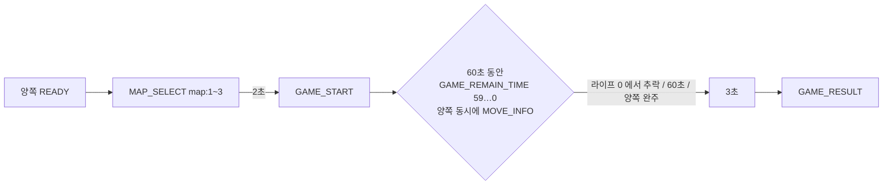

| 항목 | 값 |
|---|---|
| 맵 | 서버가 1~3 중 랜덤, 양쪽 같은 맵. 맵별 칸 수는 `STEPPING_MAP_BLOCK_COUNTS` — ⚠️ **지금은 임시값 100** |
| 라이프 | 3개. 추락하면 1개 쓰고 앞 블록 중앙(0,0)에서 재시작(연출은 클라이언트). **0개에서 또 추락(4번째)하면 게임 종료** |
| 종료 | 한 명이라도 탈락 / **60초** 경과(시트는 20초, 사용자 결정으로 변경) / 양쪽 모두 모든 칸 완주 / 둘 다 나감 |
| 결과 연출 | 종료 조건이 된 뒤 **3초** 후 `GAME_RESULT`(`STEPPING_RESULT_DELAY_SEC`, 마지막 추락 모션용). 그동안 `MOVE_INFO`·카운트다운은 멈추지만 게임 중으로 취급. 둘 다 나가면 기다리지 않음 |
| 승패 | 게임 점수 = 남은 라이프×10 + 칸 수×5. 같으면 **그 칸에 먼저 도착한 쪽**. 둘 다 0칸이면 `draw:"Y"` |
| 랭킹 점수 | 승리 **20점**, 패배·무승부 0점 (게임 점수와 별개, 로그 `vs` 에만 게임 점수가 남음) |
| `count` 검증 | **직전 값 + 1** 만 받음(추락도 같은 칸 번호). 재전송·건너뛰기·150ms 안 연타는 조용히 무시 + 서버 로그 |
| 게임 중 끊김/퇴장 | 서버가 대신 뛸 수 없으므로 **그 유저 기록이 멈춤**. 좌석은 유지, 남은 유저는 계속. `OUT_USER` 는 `GAME_RESULT` 직후. 재접속하면 `GAME_STATUS` 로 이어서 뜀 |

- ⚠️ `count` 순번 검사에 한 번 걸리면 그 클라이언트의 다음 값도 계속 어긋납니다. 클라이언트는 **서버가 중계한** `MOVE_INFO` **의 count** 를 기준으로 다음 값을 정해야 합니다.

### 6-3-2. 에어하키 (airhockey)

**서버가 퍽 물리를 직접 계산**합니다(60Hz, `airhockeyRules.StepWorld`). 클라이언트는 자기 레버 좌표만 보내고, 서버가 30Hz 로 퍽 위치와 상대 레버 위치를 보냅니다.

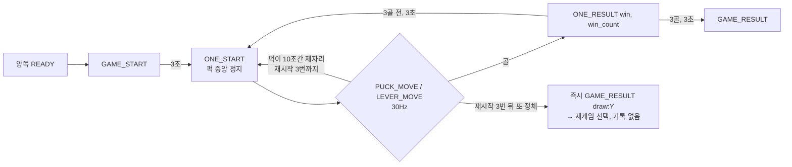

| 항목      | 값                                                                                                                                                                                                                                                                                                 |
| ------- | ------------------------------------------------------------------------------------------------------------------------------------------------------------------------------------------------------------------------------------------------------------------------------------------------- |
| 좌표계     | 원점 = 테이블 중앙, x 오른쪽 · y 위쪽. **좌표는 항상 받는/보내는 유저 기준(내 골대가 아래)**. 서버 내부는 player1 아래 · player2 위 절대 좌표이고 player2 와는 `(x,y)→(-x,-y)`                                                                                                                                                                    |
| 테이블     | 720×1280, 골대 입구 260, 퍽 반지름 30, 레버 반지름 60 — ⚠️ **임시값**, 클라이언트와 반드시 같아야 함. 영상의 꺾인 옆벽은 연출, 충돌은 직사각형(사용자 결정)                                                                                                                                                                                          |
| 레버      | 자기 쪽 절반 안으로 잘라서 받음(중앙선 못 넘음). 서버 레버는 `LEVER_MOVE` 도착 간격(이동평균)을 재서 **다음 입력이 올 때쯤 도착하는 일정한 속도**로 따라감 = 서버 레버 속도가 손 속도. 상한 3000/초(순간이동 조작 방지). 위처럼 따라가는 점은 **"손"** 이고, 레버는 그 손을 **무게(1차 지연, τ=0.05초 `AIRHOCKEY_LEVER_WEIGHT_SEC`)** 로 늦게 따라감: 매 틱 `레버 += (손-레버)×(1-e^(-dt/τ))` — 짧게 툭 친 타격은 약하게, 길게 휘두르면 손 속도 그대로(2026-10-22 사용자 요청 "퍽이 너무 쉽게 튐"). **봇은 무게 없음**(`has_weight`)                                                                                                                                                        |
| 타격      | 유한 질량 충돌식: 퍽 법선 속도 변화 = `-(1+e)·M/(M+1)·상대속도`, e=0.65, M=4 → 멈춘 퍽을 V 로 치면 **약 1.3V**. 퍽 상한 2800                                                                                                                                                                                                   |
| 시작 / 선공 | 매 판 퍽은 중앙(0,0)에 멈춘 채 시작, 먼저 친 쪽이 선공(시트)                                                                                                                                                                                                                                                           |
| 판 시작 레버 | `ONE_START` 때 레버의 **이전 궤적(속도·따라가던 목표·입력 간격)을 버리고** 그 자리에 멈춤. 그 판의 **첫** `LEVER_MOVE` **는 그 좌표에 바로 놓고(속도 0)**, 두 번째부터 평소처럼 따라감(사용자 결정, `ResetLeverMotion`/`SnapLever`). 퍽 위에 놓여도 치지 않고 밀어내기만 함                                                                                                     |
| 승리      | **3골 선취**. 제한 시간 없음(사용자 결정). 무승부(`draw:"Y"`)는 ① 둘 다 나갔는데 골 수가 같을 때 ② 정체 무효일 때뿐                                                                                                                                                                                                                    |
| 퍽 정체    | 퍽이 **10초** 동안 처음 자리에서 반경 30 밖으로 못 나가면 골 없이 **이번 판만 다시**(점수 유지, `ONE_START` 부터). 레버 사이·구석 끼임, 퍽 독점을 함께 막음(사용자 결정, `AIRHOCKEY_STUCK_`*)                                                                                                                                                             |
| 정체 무효   | 골 없이 정체 재시작을 **3번** 한 뒤 또 정체되면(4번째) **게임 무효** — **즉시** `GAME_RESULT{draw:"Y"}`(winner/loser = player1/player2, score 0, win_per 미반영) → 일반 결과와 같은 10초 재게임 선택. 별도 알림 메시지 없음(`GAME_INVALID` 는 사용자 결정으로 제거). DB 로그·통계·랭킹 없음. 골이 나면 횟수 0. 양쪽 방치면 `GAME_START` 부터 약 43초(`AIRHOCKEY_STUCK_MAX_RESTARTS`) |
| 랭킹 점수   | **넣은 골 수 × 5점**, 패자도 받음(사용자 결정, 시트 "1판에 5점")                                                                                                                                                                                                                                                      |
| 끊김 / 퇴장 | 공통 자동 모드 규칙(6-4) — **서버 봇이 레버를 조종**(끊기는 즉시). 재접속하면 `GAME_STATUS` 받고 본인 조종                                                                                                                                                                                                                         |
| 둘 다 나감  | 그 시점 골 수로 즉시 종료                                                                                                                                                                                                                                                                                   |

- ⚠️ 봇 조준 흔들기(`AIRHOCKEY_BOT_AIM_JITTER`)를 **빼지 마세요.** 둘 다 끊겨 봇끼리 붙으면 중앙 퍽에 대칭으로 달려들어 영원히 골이 안 납니다(시뮬레이션 20/20 교착 → 흔들기 ±20 이면 0/20). 재접속 창은 게임이 끝날 때까지 열려 있어 그 방이 닫히지 않습니다.
- ⚠️ 레버를 **최대 속도로 몰아서 목표까지 보내면 안 됩니다**(2026-10-15 수정 전 방식). 30Hz 입력은 2틱에 한 번 오므로 레버 속도가 `[0, 2V, 0, 2V …]` 로 튀어서, 같은 손놀림에도 퍽이 달라붙었다가 튕겨 나가고 손 600/초부터 모든 타격이 상한에 걸렸습니다. 단위 테스트가 이걸 못 잡은 이유는 목표를 한 번에 줬기 때문입니다 — `SwingAt()` 처럼 **2틱마다 목표를 바꿔** 시험하세요.
- ⚠️ 봇의 "느린 퍽에 붙어 있으면 물러나기"(`AIRHOCKEY_BOT_RETREAT_*`)를 빼지 마세요. 구석에 갇힌 퍽은 레버가 닿을 수 있는 모든 자리에서 구석 쪽으로만 밀려서, 누르고만 있으면 봇끼리 영원히 못 빼냅니다(30판 중 5판 교착 → 200판 중 0판).
- ⚠️ 물리 루프는 `this.clock.setInterval` 이 아니라 `setSimulationInterval` 입니다. 룸 clock 은 patch 주기로만 tick 돼서 16ms 간격이 보장되지 않습니다.
- ⚠️ 물리 루프는 **고정 스텝 누적**(`RunSimulationSteps`)입니다. 루프 한 번 = Tick 한 번으로 두면 Windows 타이머 해상도(15.6ms) 때문에 실제로는 초당 약 34번만 돌아 **게임 전체가 57% 속도 슬로모션**이 됩니다(2026-10-15 발견 — 정체 10초가 실제 17초였음). 실제 경과 시간을 쌓아 1/60초마다 Tick 하고, 5틱 넘게 밀리면 버립니다.
- ⚠️ 물리 루프는 **한 번 걸면 끄지 않고** `simulation_running` 플래그로만 멈춥니다. `setSimulationInterval()` 을 콜백 없이 불러 끄면 Colyseus 가 내부 핸들을 안 비워서 patch 주기의 `clock.tick()` 도 건너뛰고 **룸 clock 이 영원히 멈춥니다** — 게임이 끝난 뒤 재게임 10초 타이머가 안 울려 유저가 방에 계속 머물렀습니다(2026-10-15).
- ⚠️ `PUCK_MOVE`/`LEVER_MOVE` 는 C↔S 로그를 남기지 않습니다(`log.ts` `HIGH_FREQUENCY_MESSAGE_TYPES`). 멈춘 퍽·레버는 바뀌었을 때만 보냅니다.

### 6-3-3. 청기백기 (flag, 1인)

**혼자 하는 게임**입니다. 로비 → 채널 이동 → 방 입장 흐름은 다른 게임과 같지만, 상대를 기다리지 않습니다.

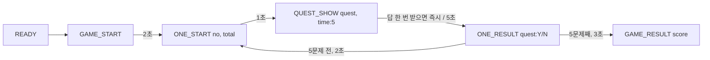

| 항목 | 값 |
|---|---|
| 매칭 | `channelNames.SOLO_GAME_TYPES` 에 있는 게임은 `JOIN_MATCH` 즉시 `GameRoomMatcher.CreateRoomForOne` 으로 1인 방. `MATCH_FOUND.opponent`·`ENTER_ROOM.player2` 생략. 기다리는 방 없음 |
| 깃발 | `b` = 청기 · **오리 오른손**, `w` = 백기 · **오리 왼손**(오리 기준). 서버는 손·화면 방향을 모르고 b/w 값만 다룸. 값: 1 올림 / 0 정지 / -1 내림 |
| 문제 | `quest:{b,w}` = **대표 정답 포즈** — 양손 × 올림/내림/정지 **9종**(클라이언트 동작 이미지 9장)을 균등하게 고름. 양손 정지 `{0,0}` 포함, 직전 문제와 같은 포즈는 안 냄. 깃발 현재 상태는 안 따짐 |
| 문구 | `say:{b,w}` — 움직이는 손은 `"up"`(올려)/`"down"`(내려), 정지인 손은 `"no_up"`(올리지마)/`"no_down"`(내리지마)/`""`(말 안 함) 중 랜덤(`FLAG_KEEP_SAY_CODES`). 양손 다 `""` 는 없음. 예: `quest {b:1,w:0}` → "청기 올려, 백기 올리지마" / "청기 올려, 백기 내리지마" / "청기 올려" |
| 답 | 손마다 **올림 · 정지 · 내림** 버튼. C→S `QUEST_SHOW{quest:{b?,w?}}`, 안 누른 깃발은 키를 빼거나 null. 클라이언트가 **문제에 나온 깃발의 버튼을 모두 받아 한 번에** 보내고, 서버는 **처음 온 답 하나로 즉시 판정**(그 뒤 답은 무시). 제한 시간 **5초**(`FLAG_ANSWER_TIME_SEC`) 안에 안 오면 N(`answer` 둘 다 null) |
| 판정 | **`say` 기준**(`IsCorrect`/`IsFlagCorrect`) — `up` → 올림만 / `down` → 내림만 / `no_up` → 내림·정지 / `no_down` → 올림·정지 / `""` → 안 누름·정지 통과, 올림·내림 오답. 양손 정지 문제도 버튼을 눌러야 정답 |
| 점수 | 맞춘 수 × 5 = 게임 점수 = 랭킹 점수. 만점 25 |
| 정답률(`win_per`) | 누적 맞춘 수 / (게임 수 × 5) — 게임마다 (맞춘 수/5)의 평균. 그래서 `flag_user_play_info.total_win_count`/`today_win_count` 에는 **맞춘 문제 수**를 쌓음(`PLAY_INFO` 도 같은 의미) |
| 재게임 | `Y` → 같은 방에서 `GAME_START` 부터, `N`/10초 무응답 → `RETURN_TO_LOBBY` |
| 게임 중 퇴장·끊김 | 현재 점수 저장, 방은 없앰 — **재접속 없음**(`onDrop`·`activeGame` 안 씀, F5 도 `REJOIN_GAME` 없음). 그때까지 맞춘 점수로 저장(게임 수 +1, 못 푼 문제는 틀림, 로그 `is_quit=1`), 마지막 클라이언트가 나가면 autoDispose. 결과 3초 대기 중 나가도 같음 |

- ⚠️ 연출 시간(`FLAG_GAME_START_DELAY_SEC` 2, `FLAG_QUEST_SHOW_DELAY_SEC` 1, `FLAG_ONE_RESULT_DELAY_SEC` 2)은 **임시값**입니다. 클라이언트 연출에 맞춰 바꾸세요.
- ⚠️ 게임 채널당 100방 상한(`MAX_ROOMS_PER_GAME_CHANNEL`)은 1인 게임에도 그대로라, 청기백기 채널은 100명이 상한입니다.

### 6-4. 끊김 · 퇴장 · 재접속 ⭐

Colyseus 에서 연결이 끊기는 경로는 두 가지이고, 서버 처리가 완전히 다릅니다.

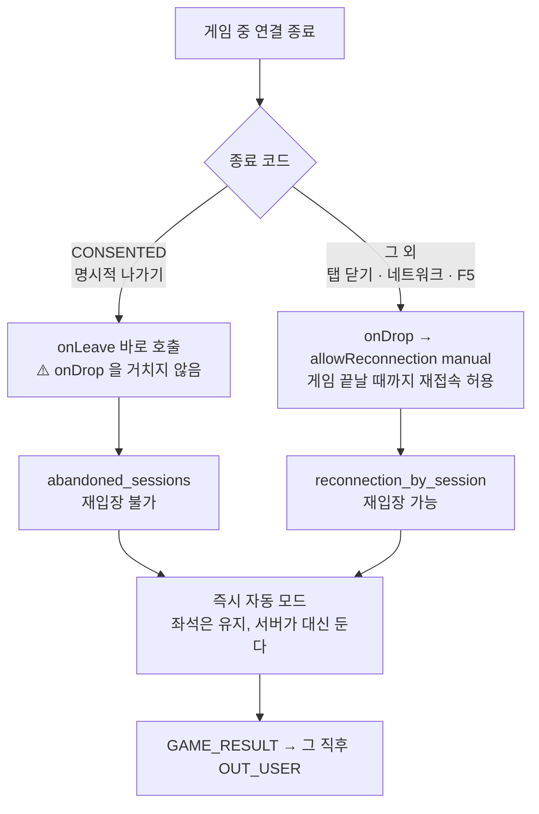

**핵심 규칙 (최종)**

| 상황          | 동작                                                                                                                           |
| ----------- | ---------------------------------------------------------------------------------------------------------------------------- |
| 자동 모드 판정    | `IsAutoSession()` = **끊겨 있음** ∨ `bot_sessions` ∨ `abandoned_sessions`. 끊기는 **즉시** 자동                                         |
| 좌석          | 비우지 않는다. 그래서 턴/판 루프가 계속 돌고 결과가 **나간 유저 승패·DB 에도 반영**됨                                                                        |
| 나간 그 턴/판    | 진행 중이던 제한 시간(10초)은 **끝까지 유지**                                                                                                |
| 오델로 다음 턴    | 제한 시간 **2초**(`OTHELLO_AUTO_TURN_TIMEOUT_SEC`), `TURN_REMAIN_TIME` 1→0 도 보냄                                                   |
| RPS 다음 판    | 남은 유저가 고르는 **즉시** 판정. 나간 쪽 값은 자동 선택과 같은 경로로 채움                                                                               |
| 턴 성격        | 턴 **시작 시점에 확정**(`turn_auto`)되고 그 턴 안에서는 바뀌지 않음                                                                               |
| 자동 턴 중 재입장  | 그 턴은 본인이 못 둔다(`SELECT_GAME` 무시). **다음 턴부터** 직접 둠                                                                             |
| `OUT_USER`  | 나가는 즉시가 아니라 `GAME_RESULT` **직후**(`FlushAbandonedPlayers`)                                                                    |
| 둘 다 나감      | 오델로: 그 시점 돌 수로 즉시 종료. RPS: 남은 판을 지연 없이 즉시 판정(`ResolveRemainingRoundsNow`, 상한 20판). 점핑·에어하키: 그 시점 기록(게임 점수 / 골 수)으로 즉시 종료     |
| DB `is_bot` | 게임이 끝날 때 `bot_sessions` 에 있으면 `win_is_bot`/`lose_is_bot` = 1. 끊김은 5초 뒤에 들어가고, **명시적 나가기는** `onLeave` **에서 즉시** 들어감. 재입장하면 빠짐 |
| 관리자 접속자 목록  | `abandoned_sessions` 는 제외                                                                                                    |
| 게임 종료       | `FinishGame` 이 남은 재접속 창을 강제로 `reject()` 함 (안 하면 방이 영원히 안 닫힘)                                                                 |

- 재입장은 **끊김(drop) 경로에만** 있습니다. 명시적 나가기는 `activeGame` 기록도 지워지므로 로비에서 새로 매칭됩니다.
- ⚠️ **F5 는 "재입장"입니다.** 클라이언트가 `REJOIN_GAME` 을 받으면 자동으로 재접속합니다(`LobbyScene.HandleRejoinGame`). "나가서 안 돌아옴"을 테스트하려면 **탭을 닫으세요**.
- ⚠️ **대가**: 1~2초짜리 네트워크 끊김이어도 그 사이에 시작된 턴/판은 서버가 둡니다.
- ⚠️ RPS 즉시 판정은 **양쪽이 다 자동이면 앞당기지 않습니다.** 기다리는 사람이 없고, 둘이 잠깐 끊겼다 돌아올 때 판이 서버 랜덤으로 끝나 버리기 때문입니다.
- ⚠️ 오델로 "둘 다 나감" 판정은 `clients.length === 0 && reconnection_by_session.size === 0` 입니다. 명시적 나가기에도 재접속 창을 열면 이 판정이 깨집니다.

### 6-5. F5 재접속 (`REJOIN_GAME`)

F5 를 누르면 클라이언트 메모리의 `reconnectionToken` 이 사라집니다. 그래서 로비가 대신 안내합니다.

1. 게임방이 `onJoin`/`onReconnect` 마다 `active_game:{userid}` 에 `{room_name, room_id, token}` 을 저장합니다(최종 `onLeave` 때 삭제).
2. 로비는 `ENTER_LOBBY` 처리 중에 이 기록을 찾고, `matchMaker.reconnect()` 로 아직 유효한지 확인합니다.
3. 유효하면 `REJOIN_GAME{reconnection_token: "roomId:토큰"}` 을 보내고 로비 연결을 끊습니다.
4. 클라이언트는 받은 값을 그대로 `client.reconnect()` 에 넘깁니다.

- ⚠️ `consumeSeatReservation()` 이 아닙니다. 토큰은 반드시 `"roomId:토큰"` 형식이어야 합니다.
- 재접속은 `onJoin` 을 다시 부르지 않습니다. 그래서 `ENTER_ROOM` **재요청**이 상대 정보와 상태를 되찾는 유일한 경로입니다. 서버는 재요청한 클라이언트에게만 다시 보내고, 오델로·점핑·에어하키는 `GAME_STATUS` 도 함께 보냅니다(RPS 는 없음).

---

## 7. 통신 프로토콜

> 📄 **기준 문서는 구글 시트**(로컬 엑셀본 `멀티게임_바이브.xlsx` 의 `lobby` / `rps` / `othello` / `stepping` / `airhockey` / `관리자` 시트)입니다.
> https://docs.google.com/spreadsheets/d/1zmxIhBU8UsEiI4cFFBs94Y4gNfsl1QbINjZMGQwNzBQ
> 시트에 있는 메시지는 시트가 우선이고, 시트에 없는 것(🔸 표시)만 이 문서가 기준입니다.

### 7-1. 공통 규칙

- envelope 은 `{ "type": "…", "payload": {…}, "ts": "10-02 15:12:10:99" }` 입니다. `ts` 는 표시 전용 문자열입니다.
- C→S 는 `{payload:{…}}` 와 평탄한 `{…}` 둘 다 받습니다(`RegisterLoggedMessage` 가 `ReadPayload` 로 벗김).
- **응답은 요청과 같은 type 을 재사용합니다.**
- 서버가 끊을 때는 항상 종료 코드를 줍니다: 이동은 `CONSENTED`(4000), 오류는 `WITH_ERROR`(4002). 코드가 없으면 SDK 가 자동 재접속을 시도합니다.
- `game` 필드는 생략하면 `"rps"` 입니다. 모르는 값은 조용히 무시합니다.

### 7-2. 로비

| type | 방향 | payload | 비고 |
|---|---|---|---|
| ENTER_LOBBY | C→S | `{partner, mid, gender(F/M), phone}` | 접속 후 10초 안에 안 오면 `ERROR{ENTER_TIMEOUT}` + 종료 |
| ENTER_LOBBY | S→C | 성공 `{result:"Y", userid, new:"Y/N", name, avatar}` · 실패 `{result:"N", error}` | `new:"Y"` + 빈 name → 별명 화면 |
| NAME | C→S / S→C | `{name}` / `{result, error?}` | 이미 별명이 있어도 갱신 🔸 |
| PLAY_INFO | C→S / S→C | `{game?}` / `{result:"Y", game, total_game_count, total_win_count, today_game_count, today_win_count}` | 그 게임의 통계 |
| RANK_DAILY | C→S / S→C | `{game?}` / `{game, date, list:[[name,score]…], my:{rank,score}}` | 100명, 동점 공동 순위, 기록 없어도 `my` 옴 |
| RANK_WEEKLY | C→S / S→C | `{game?}` / `{game, term:{start,end}, list, my}` | 월~일 |
| JOIN_MATCH | C→S | `{select:"Y/N", game?}` | `N` = 매칭 대기 취소 |
| MATCH_FOUND 🔸 | S→C | `{game, room_name, room_id, seat_reservation, opponent:{name, avatar}}` | 상대 userid 는 보내지 않음 |
| REJOIN_GAME 🔸 | S→C | `{game, room_name, room_id, reconnection_token}` | 6-5 참고 |
| ERROR 🔸 | S→C | `{code, message}` | `ENTER_TIMEOUT`(종료), `NO_GAME_ROOM`(연결 유지) |

**결과 코드**

| type | 1 | 2 | 3 | 4 |
|---|---|---|---|---|
| ENTER_LOBBY | 형식 오류 | 중복 접속 | DB/Redis 오류 | 기타(인원 초과 등) |
| NAME | 사용 중인 별명 | 부적절한 별명(형식·금칙어) | 서버 오류 🔸 | - |

### 7-3. 게임방 공통

| type | 방향 | payload | 비고 |
|---|---|---|---|
| ENTER_ROOM | C→S / S→C | `{}` / `{result:"Y", room, player1, player2}` | player = `{userid, name🔸, avatar, win_per}`. 재요청하면 그 클라이언트에게만 다시 |
| READY | C→S | `{ready:"Y/N"}` | |
| GAME_START | S→C | `{}` | |
| OUT_USER | S→C | `{userid}` | 게임 중 퇴장은 `GAME_RESULT` 직후 |
| GAME_RESULT | C→S | `{replay:"Y/N"}` | `N` 🔸 |
| OPPONENT_JOINED | S→C | `{player:{userid, name, avatar, win_per}}` | 기다리는 방에 새 상대 |
| RETURN_TO_LOBBY | S→C | `{}` | 그 유저에게만. 어떤 코드로 끊어도 SDK 가 자동 재접속하지 않음 |
| SEND_NOTICE | S→C | `{message}` | 관리자 공지 |

### 7-4. 가위바위보

| type | 방향 | payload | 비고 |
|---|---|---|---|
| ONE_START | S→C | `{count:10}` | |
| ONE_REMAIN_TIME | S→C | `{count}` | 9 … 0 |
| SELECT_GAME | C→S | `{select:"가위/바위/보"}` | |
| ONE_RESULT | S→C | `{player1, player2, win?}` | 무승부면 `win` 생략 |
| GAME_RESULT | S→C | `{winner:{userid,win_count,win_per}, loser:{…}}` | `win_count` = 이긴 판 수, `win_per` = 이번 결과 반영된 승률. 점수는 안 보냄 |

### 7-5. 오델로

| type | 방향 | payload | 비고 |
|---|---|---|---|
| DOLL_SELECT | C→S / S→C | `{color:0/1}` / `{select:{"0":userid, "1":userid}}` | |
| DOLL_SELECT_REMAIN_TIME | S→C | `{count}` | |
| TURN_START | S→C | `{turn, can:[{x,y}…]}` | `can` 🔸 = 놓을 수 있는 자리 |
| TURN_REMAIN_TIME | S→C | `{count}` | 사람 9…0, **자동 1→0** |
| SELECT_GAME | C→S / S→C | `{select:{x,y}}` / `{select:{userid,x,y}, change:[{x,y}…]}` | 자동 착수도 같은 모양 |
| GAME_STATUS | S→C | `{select, status0, status1, turn?, can?}` | 재접속 당사자에게만. `turn`/`can` 🔸 은 턴 공백(2초)이거나 **본인 자동 턴**이면 생략 |
| GAME_RESULT | S→C | `{winner, loser, draw?:"Y"}` | `win_count` = **최종 돌 개수**, `draw` 🔸 |

### 7-5-1. 점핑

| type | 방향 | payload | 비고 |
|---|---|---|---|
| MAP_SELECT | S→C | `{map}` | ⚠️ 시트는 `MAP_SEELCT` 오타. 와이어 이름은 `MAP_SELECT` |
| GAME_REMAIN_TIME | S→C | `{count}` | 59 … 0 (제한 60초) |
| MOVE_INFO | C→S / S→C | `{count, location:{x,y}, save:"yes"/"no"}` / 같은 값 + `userid`, `life`🔸 | 받아들인 것만 **양쪽 모두**에게 중계 |
| GAME_STATUS 🔸 | S→C | `{map, count?, player1, player2}` — player = `{userid, count, life, location}` | 재접속 당사자에게만. 시트 행은 오델로 것이 복사돼 있어 새로 정함. `count`(남은 초)는 GAME_START 전이면 생략 |
| GAME_RESULT | S→C | `{winner, loser, draw?}` — `{userid, win_count, win_per, score🔸, life🔸}` | `win_count` = 이동한 칸 수, `score` = 게임 점수 |

### 7-5-2. 에어하키

| type        | 방향        | payload                                                           | 비고                                                                                                                                                           |
| ----------- | --------- | ----------------------------------------------------------------- | ------------------------------------------------------------------------------------------------------------------------------------------------------------ |
| GAME_START  | S→C       | `{}`                                                              | 시트 비고의 "MAP_SEELCT 후 2초"는 점핑 시트 복사 흔적 — 맵 없음, READY 직후                                                                                                       |
| ONE_START   | S→C       | `{}`                                                              | 한 판(한 골) 시작. 직후 `PUCK_MOVE (0,0)` 한 번                                                                                                                        |
| PUCK_MOVE   | S→C       | `{loc:{x,y}, vel🔸:{x,y}}`                                        | 받는 유저 기준, 정수. 움직일 때만 30Hz. `vel`(단위/초)로 다음 패킷까지 위치 예측 가능, 멈추면 `vel (0,0)` 이 한 번 옴                                                                            |
| LEVER_MOVE  | C→S / S→C | `{loc:{x,y}}` / `{user, loc}`                                     | 내 기준 좌표. 중계는 **상대에게만**, 상대 기준으로 뒤집어서. 봇 레버도 같은 경로                                                                                                            |
| ONE_RESULT  | S→C       | `{win, win_count}`                                                | 골 넣은 유저와 그 유저의 누적 골                                                                                                                                          |
| GAME_STATUS | S→C       | `{puck:{loc, vel🔸}, LEVER0, LEVER1, win_count0🔸, win_count1🔸}` | 재접속 당사자에게만, 그 유저 기준 좌표. LEVER0/1 = player1/2                                                                                                                 |
| GAME_RESULT | S→C       | `{winner, loser, draw}` — `{userid, win_count, score, win_per}`   | `win_count` = 골 수, `score` = 골×5. `draw` **는 항상** `"Y"`**/**`"N"` — 클라이언트는 이 값으로 결과 화면을 고름. `"Y"` = 둘 다 나갔는데 골 수 같음 또는 정체 무효(winner/loser = player1/player2) |

### 7-5-3. 청기백기 (1인)

| type | 방향 | payload | 비고 |
|---|---|---|---|
| ENTER_ROOM | S→C | `{result:"Y", room, player1}` | `player2` 없음. 혼자라 바로 응답 |
| GAME_START | S→C | `{}` | READY 직후. 시트 비고의 "MAP_SEELCT 후 2초"는 복사 흔적 |
| ONE_START | S→C | `{no🔸, total🔸}` | 몇 번째 문제(1~5) / 5 |
| QUEST_SHOW | S→C | `{quest:{b,w}, say🔸:{b,w}, time🔸:5}` | 문제. `quest` = 대표 정답 포즈(이미지), `say` = 문구 코드 `up/down/no_up/no_down/""`(판정 기준, 6-3-3) |
| QUEST_SHOW | C→S | `{quest:{b?,w?}}` | 답. 1 올림 / 0 정지 / -1 내림, 안 누른 깃발은 생략. 문제에 나온 깃발 버튼을 모아 **한 번에**, 처음 온 답으로 판정 |
| ONE_RESULT | S→C | `{quest:"Y"/"N", score🔸, answer🔸:{b,w}}` | `score` = 누적 점수. `answer` 의 `null` = 안 누름 |
| GAME_RESULT | S→C | `{score, correct_count🔸, win_per🔸}` | 마지막 ONE_RESULT 3초 뒤. `win_per` = 이번 결과까지 반영한 정답률 |
| OUT_USER / OPPONENT_JOINED / GAME_STATUS | - | - | 1인·재접속 없음이라 **안 씀** |

### 7-6. 관리자 (Watcher)

| type | 방향 | payload | 비고 |
|---|---|---|---|
| ADMIN_LOGIN 🔸 | C→S / S→C | `{id, password}` / `{result:"Y/N"}` | 10초 안에 통과 못 하면 종료 |
| ADMIN_CHANNEL_COUNT | C→S / S→C | `{game?}` / `{game, count:{lobby_1:20, rps_1:199 …}}` | 실시간 집계 |
| ADMIN_CHANNEL_USER | C→S / S→C | `{game?, channel:"rps_1"}` / `{game, channel, user:[{userid, room?}], total}` | 최대 5초 지난 스냅샷. 옛 숫자 형식은 폐지 |
| SEND_NOTICE | C→S | `{game?, channel:[…], message, time?:{mon,day,start,end}}` | 지정한 채널에만. `time` 이 있으면 구간 동안 1분마다 반복 |

---

## 8. 서버 내부 설계

### 8-1. 채널 하트비트 · 방 생성 라우팅

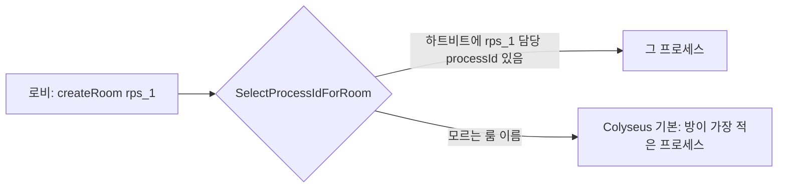

- Colyseus 기본 라우팅은 **룸 이름을 보지 않고** 방이 가장 적은 프로세스를 고릅니다. 그래서 로비가 `rps_1` 을 모르는 프로세스로 라우팅되어 `not defined` 로 실패한 적이 있습니다.
- 해결: 각 채널이 5초마다 `channel:{type}:{no}:alive = processId` 를 갱신합니다(TTL 15초). `new Server({ selectProcessIdToCreateRoom })` 가 이 값으로 정확한 프로세스를 지목합니다.
- 매칭할 때는 **하트비트가 살아 있고 닫는 중이 아닌** 채널만 시도합니다.
- ⚠️ 첫 하트비트는 `await` 로 기다립니다. 그러지 않으면 로비가 자기 룸을 만들 때 경합이 생깁니다.

### 8-2. 무중단 재시작 (게임 채널만)

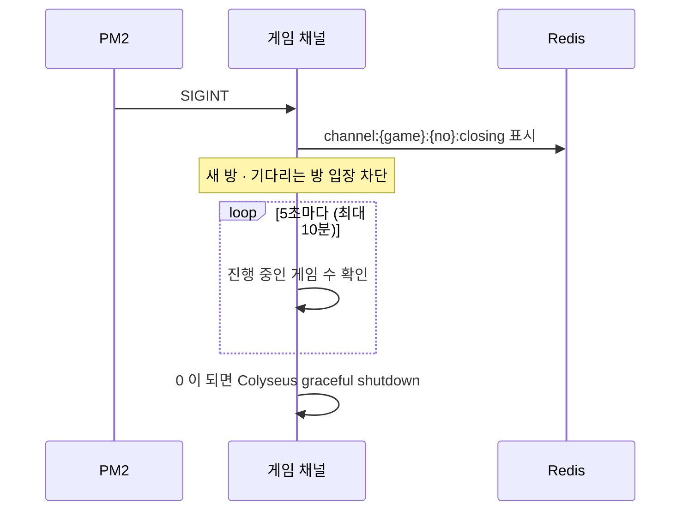

- `server.onBeforeShutdown` 은 Colyseus 가 클라이언트를 전부 끊기 **전에** 호출됩니다. 그 안에서 기다립니다.
- "진행 중" = `game_started && !game_over` 입니다. **기다리는 방은 제외**합니다. 포함하면 서로를 막아 교착 상태가 됩니다.
- 기동할 때 이전 생애의 `closing` 표시를 지웁니다. 이 분기는 `IsGameType()` 으로 일반화되어 있습니다.
- 로비/Watcher 는 그냥 재시작합니다. 운영할 때는 로비 2개, 게임 채널 3개를 **하나씩** 재시작하세요.

### 8-3. 랭킹

- MySQL `{game}_rank_daily` / `{game}_rank_weekly` 가 **원본**이고, Redis Sorted Set `rank_zset:{game}:…` 은 **조회용 인덱스**입니다. 게임 결과는 두 곳에 이중으로 씁니다.
- 본인 순위는 `ZSCORE` + `ZCOUNT(내 점수 초과) + 1` 로 구합니다. 둘 다 O(log N)이고, 동점자는 공동 순위입니다. `ZREVRANK` 는 동점자에게 다른 순위를 매겨서 쓰지 않습니다.
- ZSET 이 비어 있으면 MySQL 에서 자동으로 다시 채웁니다. 이름을 붙인 Top 100 은 10초 동안 캐시합니다.
- "오늘"은 KST 00:00~23:59, "이번 주"는 월요일부터입니다.

### 8-4. 자정 롤오버 (지연 초기화)

스케줄러는 없습니다. 조회할 때 `today_date != CURDATE()` 면 0 으로 보정하고, 다음 결과를 반영할 때 실제로 리셋합니다.

### 8-5. 관리자 채널 보안

| 방어 | 내용 |
|---|---|
| 자격증명 | `.env` 에만 둡니다. 비어 있으면 Watcher 자체가 기동하지 않습니다 |
| 무차별 대입 | 같은 IP 에서 5회 실패하면 10분 잠금입니다. 잠긴 동안에는 접속 자체가 `AUTH_FAILED`(525)로 실패합니다 |
| 헤더 위조 | `x-forwarded-for` 등이 붙은 접속은 거부합니다. ⚠️ **리버스 프록시를 두면 이 검사를 지워야 합니다** |
| 비교 | SHA-256 후 `timingSafeEqual` 로 비교하고, id/pw 를 단축 평가하지 않습니다 |
| 로그 | `ADMIN_LOGIN` payload 는 통째로 생략하고, `password`/`token` 키는 어디에 있든 `***` 로 바꿉니다 |

### 8-6. 공지 전파

관리자 → Watcher → Redis Pub/Sub(모든 채널이 구독) → 각 채널이 `channel` **목록에 자기 room_name 이 있을 때만** 그 Room 의 클라이언트에게 보냅니다.

- 반복 예약은 Watcher 메모리에만 있습니다. Watcher 가 재시작하면 사라집니다.
- ⚠️ 검증할 때 운영 채널 이름을 쓰면 실제 유저에게 공지가 갑니다.

---

## 9. DB

`src/db/schema.sql` 이 기준입니다. 월별 로그 테이블은 `EnsureXxxGameLogTable()` 이 필요할 때 만듭니다.

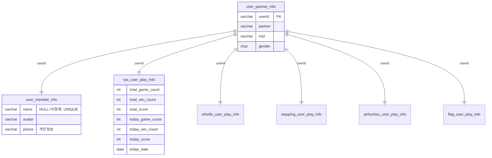

| 테이블 (게임별 `{game}_` 접두사) | 내용 |
|---|---|
| `{game}_user_play_info` | 위 그림. **가입할 때 모든 게임 행을 함께 생성**(`userInfo` 가 INNER JOIN 이라 행이 없으면 로그인이 깨짐) |
| `{game}_rank_daily` / `_weekly` | `(date_game 또는 date_start, userid, score)` |
| `rps_game_log_YYYY_MM` | `start_time, end_time, win, lose, vs("2:0"/"2:1"), score(20/10), plays, win_is_bot, lose_is_bot` |
| `othello_game_log_YYYY_MM` | 위와 같고 `vs`=돌 수(`"45:19"`), `score`=20/0, `plays`=`[{userid,x,y}…]`, `is_draw` 추가 |
| `stepping_game_log_YYYY_MM` | 오델로와 같고 `map` 추가, `vs`=게임 점수(`"30:15"`), `plays`=`[{userid,count,x,y,save}…]`(받아들인 MOVE_INFO 만) |
| `airhockey_game_log_YYYY_MM` | 오델로와 같은 컬럼, `vs`=골 수(`"3:1"`), `score`=승자 골×5, `plays`=골 기록 `[{userid,sec}…]`(퍽 좌표는 안 남김) |
| `flag_game_log_YYYY_MM` | 1인이라 `win/lose/vs/is_draw` 대신 `userid, score, correct_count, quest_count`(판정한 문제 수), `plays`=`[{quest,say,answer,result}…]`(`answer` 의 null = 안 누름), `is_quit`(게임 중 나감) |

- RPS `plays` 는 `[{ "userid1": "가위", "userid2": "보" }, …]` 이고 무승부 판도 포함합니다(2026-10-02 이전 로그는 옛 형식).
- 오델로 무승부는 `win`/`lose` 에 player1/player2 를 넣고 `is_draw=1` 로 구분합니다.
- ⚠️ **컬럼 변경은** `db:init` **이 반영하지 않습니다**(`CREATE TABLE IF NOT EXISTS`). 기존 테이블은 따로 `ALTER` 해야 합니다.
- ⚠️ FK/인덱스 **제약 이름은 DB 전역에서 유일**해야 합니다. 게임을 복제할 때 반드시 바꾸세요.
- ⚠️ `IF(...)` 같은 식으로 만든 컬럼은 mysql2 가 **문자열**로 돌려줍니다. `CAST(... AS UNSIGNED)` 로 감싸세요.
- 다른 환경에서 `db:init` 을 하기 전에는 기존 테이블 구조부터 확인하세요.

---

## 10. 검증 스크립트 (`scripts/check-*.mjs`)

실서버를 띄워야만 확인되는 것을 재현할 수 있게 남겨 둔 것입니다. **⚠️ 지우지 마세요.**

| 스크립트 | 확인 내용 | 마지막 결과 |
|---|---|---|
| `check-othello-game.mjs` | 매칭 → 60수 → 결과 → DB | 18/18 |
| `check-othello-reconnect.mjs` | 재접속 + `GAME_STATUS` | 17/17 |
| `check-othello-abandon.mjs` | 퇴장 · 자동 2초 · 재입장 · OUT_USER 시점 | consent/drop 각 41/41 |
| `check-rps-abandon.mjs` | 퇴장 · 즉시 판정 · 둘 다 퇴장 | consent/drop 각 37/37 |
| `check-stepping-game.mjs` | 매칭 → 맵 → MOVE_INFO 검증(무시 3종) → 4번째 추락 종료 → 결과 3초 대기 → 재게임 + 퇴장 → 60초 종료 → OUT_USER → DB | 34/34 (수정 전 빌드에서 3초 대기 2건 실패 확인) |
| `check-airhockey-game.mjs` | 매칭 → 좌표 뒤집기·중앙선 자르기 → 퍽 정체 10초 → 판 다시 시작 → 판의 첫 LEVER_MOVE 가 끌려오지 않고 바로 놓임 → 슛·골(양쪽 궤적 반대) → 골 연출 중 끊김·재접속 `GAME_STATUS` → 3골 → 결과 3초 → 재게임 + 퇴장(봇이 3골) → OUT_USER → 재게임 무응답 10초 → RETURN_TO_LOBBY → DB. 테스트 유저끼리 매칭되지 않으면 멈추고, 예외가 나도 정리는 돈다. `MODE=invalid` = 양쪽 방치 → 재시작 3번 → 4번째 정체에서 즉시 `GAME_RESULT{draw:"Y"}`(GAME_INVALID 없음) → A `N` 즉시 / B 무응답 10초 로비, activeGame·DB 기록 없음(약 65초) | 54/54, invalid 24/24 (봇을 끈 빌드에서 8건, clock 수정 전 빌드에서 무응답 1건, 고정 스텝 수정 전 빌드에서 정체 2건 실패 확인) |
| `check-flag-game.mjs` | 즉시 MATCH_FOUND(opponent 없음) → ENTER_ROOM player1 만 → 대표 정답 즉시 Y(뒤에 보낸 답 무시) / 반대 방향 정답(내리지마→올림) / 깃발 둘 중 하나만 보냄 또는 틀린 방향 즉시 N / 무응답 5초 N(answer null) → 결과 3초 → 재게임 만점 → 무응답 10초 RETURN_TO_LOBBY → 게임 중 LEAVE·소켓 끊김 각각 현재 점수 저장 + 방 제거 + REJOIN_GAME 없음 → DB 4행·정답 누적·랭킹 → 모든 `QUEST_SHOW.say` 가 quest 와 맞는지. 1인이라 실제 클라이언트와 매칭이 섞이지 않음(약 100초) | 30/30 |
| `check-admin-login.mjs` / `check-send-notice.mjs` / `check-enter-lobby.mjs` | 관리자 보안 / 공지 필터 / 로비 payload | 통과 |

**쓸 때 지킬 것**

- `ROOM_ID` 로 방을 고정하세요. `joinOrCreate` 는 같은 이름을 쓰는 **다른 프로세스의 방**을 돌려줄 수 있습니다. 그러면 옛 코드를 "통과"로 오판합니다. roomId 는 기동 로그에서 확인하고, 소문자와 `_` 가 섞여 있으니 잘리지 않게 주의하세요.
- 퇴장 검증은 `LEAVE_MODE=consent`(→`onLeave`)와 `LEAVE_MODE=drop`(→`onDrop`)을 **둘 다** 돌리세요.
- 테스트 유저는 전용 접두사(`zz…`)로 만들고 끝에 자기 행만 지웁니다. DB 단정은 접두사가 아니라 **그 게임의 userid** 로 좁히세요.
- ⚠️ 게임을 추가하면 **모든 check 스크립트의 정리 목록**에 `{game}_user_play_info` 를 넣으세요. 가입 시 모든 게임 행이 생기므로, 빠지면 `user_partner_info` 삭제가 FK 로 실패합니다.
- 정리는 `Close()` 가 아니라 `Leave()` 로 하세요. `Close()` 는 재접속 창을 열어서 방이 몇 분 더 살아 있습니다.
- 오래 걸리는 스크립트의 출력을 `| head` 로 자르지 마세요. SIGPIPE 로 정리 단계가 안 돕니다. 파일로 받으세요.
- **"통과"가 그 경로를 밟았다는 뜻은 아닙니다.** 버그 구간에 들어갔는지(예: "나간 지 5초 안에 턴 시작")를 단정에 넣고, 수정을 뺀 빌드에서 **실패하는 것부터** 확인하세요.
- 재접속 토큰은 프레임이 아니라 **접속 URL 쿼리**(`?reconnectionToken=`)로 보냅니다.
- ⚠️ **로비 매칭 큐는 실제 클라이언트와 공용**입니다. 사용자가 클라이언트로 테스트 중일 때 돌리면 테스트 유저가 실제 유저와 매칭됩니다(2026-10-15 실제로 겪음). 실행 전에 `~/.pm2/logs/<채널>-out.log` 에서 최근 접속을 확인하세요. `check-airhockey-game.mjs` 는 테스트 유저끼리 매칭되지 않으면 멈추고, 예외가 나도 정리 단계를 `finally` 에서 돌립니다.

---

## 11. 코딩 컨벤션 · 함정

### 컨벤션

- 함수는 CamelCase, 변수는 snake_case, 주석과 문서는 한국어로 씁니다.
- 내부 모듈 함수는 **네임스페이스 import** 로 씁니다: `import * as messages from "./messages.js"` → `messages.SendResult()`.
  - 타입, 클래스, npm 패키지는 예외입니다. `config.ts` 도 예외로 `import { config }` 를 씁니다.
  - 지역 변수와 이름이 겹치면 `useridUtils` 처럼 다른 별칭을 씁니다.
- 매니저(Watcher/Lobby/Matcher/Room)는 SQL 을 직접 쓰지 않습니다. 반드시 `db/` 모듈을 거칩니다.
- DB/Redis 접속 정보와 관리자 계정은 `.env` 에만 둡니다.
- 1차 구현은 `partner + mid` 만으로 식별합니다. 파트너 토큰 검증을 끼워 넣기 쉬운 구조(`VerifyAuth`)를 유지하세요.
- 새 게임은 기존 게임 패턴을 그대로 복제합니다(12장 체크리스트).

### Colyseus · 비동기 함정

| ⚠️ 함정 | 해결 |
|---|---|
| 등록 안 된 C→S 메시지가 오면 **조용히 연결을 끊음** | 시트에 있는 C→S 메시지는 전부 `RegisterLoggedMessage` 로 등록 |
| `onJoin` 안에서 보낸 메시지는 핸드셰이크 전이라 **전달 안 됨** | 거부/검사는 첫 클라이언트 메시지(`ENTER_LOBBY` 등) 시점에 |
| `client.leave()` 뒤 `onLeave` 는 **나중에** 실행됨 | `onLeave` 에서 정리할 때 `sessionId` 로 주인인지 확인 |
| `await` 에 룸 필드 참조를 넘기면 그 사이 비워질 수 있음 | `plays: [...this.plays]` 처럼 **복사본** 전달 |
| `CONSENTED` 퇴장은 `onDrop` 을 건너뜀 | 퇴장 처리는 `onLeave` 와 `onDrop` 둘 다 고려 |
| `CheckSeatFillTimeout` 이 게임 중에도 돌아 방을 통째로 끊음 | 맨 앞에 `if (this.game_started) return;` |
| `createRoom()` 을 `listen()` 전에 호출하면 실패 | 로비 룸은 `listen()` 뒤에 생성 |

### 로그

- `phone` 은 뒷 4자리만 남기고 마스킹합니다. `password`/`token` 은 `***` 로 바꿉니다.
- 통계성 메시지(`PLAY_INFO`/`RANK_*`/`GAME_RESULT`)는 payload 를 `[통계 데이터 생략]` 으로 찍습니다.
- 에러는 `[모듈명] 설명 실패:` 형식으로 반드시 남깁니다.

---

## 12. 새 게임 추가 체크리스트

오델로를 추가하면서 실제로 검증한 순서입니다.

| # | 할 일 | ⚠️ 놓치기 쉬운 점 |
|---|---|---|
| 1 | `.env` `{GAME}_PORTS`, `constants.ts` `{GAME}_CHANNEL_COUNT`, `config.ts` | |
| 2 | `channelNames.ts` — `GameType`, `ALL_GAME_TYPES`, `GetGameChannelCount`, `GetChannelPort` | `channelNames.test.ts` 의 `IsGameType` 단정도 수정 |
| 3 | `game/{game}/` — Room, rules(순수 함수 + 테스트), types, constants | RPS Room 의 플랫폼 공통부(입장·재접속·재게임·퇴장 자동 모드)를 복제 |
| 4 | `schema.sql` 통계/랭킹 테이블, `{game}GameLogSchema.ts`, `initDb.ts` | 제약 이름 변경 |
| 5 | `queries/{game}GameLog.ts`, `{game}GameResultRepository.ts` | `[...plays]` 복사본 |
| 6 | `userRegistration.ts` 의 `GAME_PLAY_INFO_TABLES` 에 추가 | 기존 유저는 `db:init` 이 백필 |
| 7 | `index.ts` 분기, `LobbyManager.CreateMatchersByGame` | `index.ts` 는 `IsGameType()` 으로 일반화돼 있어 거의 안 고침 |
| 8 | `ecosystem.config.cjs`, `package.json` `start:{game}N` | |
| 9 | `check-{game}-*.mjs` 검증 스크립트 | consent/drop 둘 다 |

---

## 13. 아직 남은 것

| 항목 | 상태 |
|---|---|
| 운영 TLS 인증서 + 모든 채널 wss 실측 | 미완 |
| Watcher 포트(6001) 외부 공개 제한(방화벽/IP) | 운영 배포 때 결정 |
| 무중단 재시작 — 실제 게임 진행 중 SIGINT 리허설 | 운영 배포 전 1회 필요 |
| 파트너사 토큰 검증 | 상용 오픈 전 필수 |
| 매칭 폭주(완전 동시 200명+) 순차 처리 병목, 100번째 방 경계 경합 | 알려진 한계, 보류 |
| 매칭 게임 채널 B안(`ip`/`port` 직접 전달) | 사용자가 나중에 바꿀 수 있음. 바꾸면 좌석 예약의 "이 자리는 이 유저" 보장을 다시 설계해야 함 |
| 점핑 맵별 칸 수 | `STEPPING_MAP_BLOCK_COUNTS` 가 임시값(100). 실제 맵 데이터 받으면 교체 |
| 점핑 재접속(`GAME_STATUS`) 실서버 검증 | 단위 수준만. `check-stepping-reconnect.mjs` 미작성 |
| 에어하키 테이블/퍽/레버 크기 | `airhockeyConstants.ts` 의 크기·속도·지연이 임시값. 클라이언트 값 받으면 맞춰야 함 |
| 에어하키 지연 보상 | 서버 권위 물리라 내 레버 → 퍽 반응에 왕복 지연이 그대로 보임. 클라이언트는 `PUCK_MOVE.vel` 로 예측해 그려야 함 |
| 에어하키 클라이언트 (사용자 작업) | ① `PUCK_MOVE` 를 `loc + vel×경과초` 로 예측해 그리기(안 하면 30Hz 로 뚝뚝 끊김) ② `GAME_RESULT.draw` 로 결과 화면 분기(`"Y"` = 무승부·무효) ③ `LEVER_MOVE` 를 손가락 위치로 계속 보내기(판의 첫 입력이 시작 위치). **보내는 값은 손가락 위치 그대로**, 내 레버를 **그릴 때만** 서버와 같은 무게 공식(τ=0.05, 손=손가락, 0.5 이내면 딱 맞춤, 판의 첫 입력은 바로 놓기)을 적용. 상대 레버는 다시 늦추지 않음 ④ 테이블·퍽·레버 크기를 서버 값과 일치 — 신고 화면에서 퍽이 테두리 밖에 그려져 크기/비율 차이가 의심됨 |
| 청기백기 클라이언트 (사용자 작업) | `game:"flag"` 매칭, 상단 문제 판넬·가운데 오리·손마다 올림/정지/내림 버튼 UI, `QUEST_SHOW` 송수신(`say` 로 문장 만들기, `quest` 로 정답 포즈 이미지 9장 중 선택, 문제에 나온 깃발 수만큼 눌리면 **한 번에** 전송), `MATCH_FOUND.opponent`/`ENTER_ROOM.player2` 없는 경우 처리. 시트 flag 탭 H열(빨간 글씨)이 서버 기준 |
| 엑셀 시트 반영 (사용자 작업) | 에어하키: `GAME_RESULT.draw` 항상 Y/N(정체 무효 = draw:Y), 판 시작 레버 규칙, 퍽 정체 10초 재시작, `PUCK_MOVE.vel`, `GAME_START` 비고(맵 없음), `GAME_STATUS.win_count0/1`, `GAME_RESULT.score`=골×5·`draw` 조건, 좌표계·테이블 크기. 점핑: 제한 시간 20초→60초, `MAP_SEELCT`→`MAP_SELECT`, `MOVE_INFO.life`, `GAME_STATUS` 새 모양, `GAME_RESULT.score/life`, 라이프·점수 규칙. 기존: `TURN_START.can`, `GAME_RESULT.draw`, 오델로 `win_count`=돌 수, `OUT_USER` 지연 전송, 자동 턴 2초, `GAME_STATUS` turn/can 생략 |
