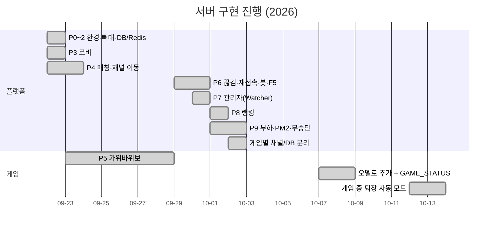
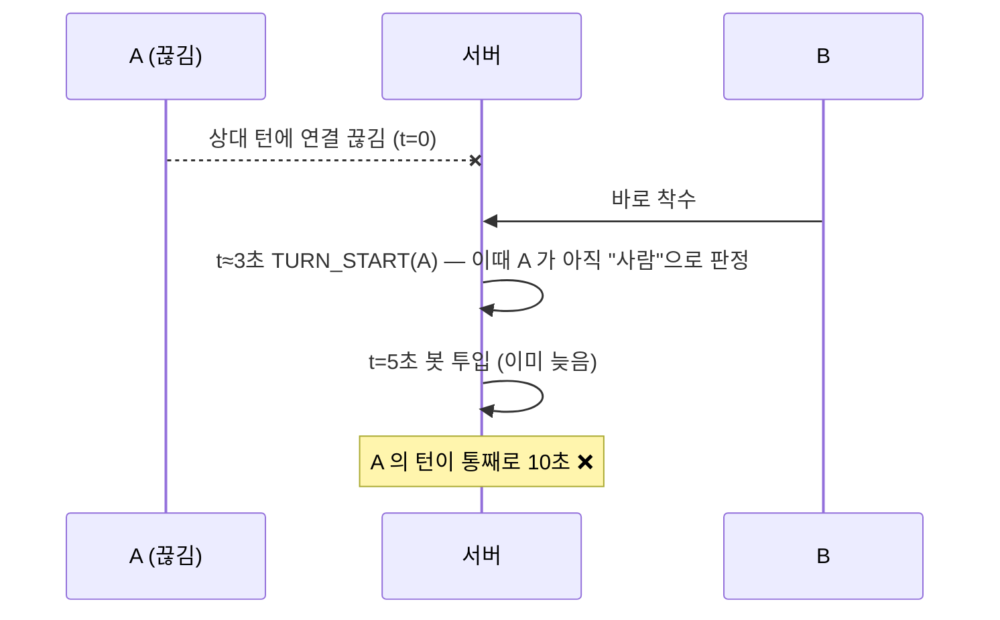

# TASKS.md — 작업 현황

> 설계와 규칙의 기준은 `CLAUDE.md` 이고, 이 문서는 **무엇이 끝났고 무엇이 남았는지**만 다룹니다.
> 📦 2026-10-13 이전의 단계별 상세 기록(체크박스, 경위, 실측값)은 `docs/archive/TASKS_2026-10-13.md` 에 원본 그대로 있습니다.

---

## 1. 진행 현황 한눈에 보기

| 단계 | 상태 | 핵심 결과 |
|---|---|---|
| P0~2 환경 · 뼈대 · DB/Redis | ✅ | Colyseus 0.18 + Redis Presence, `userRepository` 단일 입구, TTL 120초 캐시 |
| P3 로비 | ✅ | `ENTER_LOBBY`/`NAME`, 인원 300 제한, 결과 코드 통합 |
| P4 매칭 · 채널 이동 | ✅ | 좌석 예약으로 유저 정보 전달(게임방 DB 조회 0회), 하트비트 기반 채널 선택 |
| P5 가위바위보 | ✅ | 2선승, 재게임/기다리는 방, 결과 DB + write-through |
| P6 예외 처리 | ✅ | `onDrop` 재접속(게임 끝까지), 봇, F5 → `REJOIN_GAME` |
| P7 관리자 | ✅ 서버 범위 | 로그인(IP 잠금), 채널 인원/목록, 채널 지정 공지 + 반복 |
| P8 랭킹 | ✅ | Redis ZSET + MySQL 원본, 자정 지연 초기화 |
| P9 부하 · 배포 준비 | 🟡 | 로비 300명 OK, PM2, 무중단 재시작. **운영 TLS 남음** |
| 게임별 분리 | ✅ | `rps_*`/`othello_*` 채널 · 테이블 · Redis 키 분리 |
| 오델로 | ✅ | 60수 e2e, 패스, `GAME_STATUS` 재접속 복원 |
| 게임 중 퇴장 (두 게임) | ✅ | 끊기는 즉시 자동 모드, 결과는 나간 유저에게도 반영 |

---

## 2. 최근 작업 요약 (2026-10-12 ~ 10-13)

### 게임 중 퇴장 → 자동 모드 (오델로 · RPS)

| 요구사항 | 구현 |
|---|---|
| 나간 유저 차례는 서버가 자동으로 | 좌석 유지 + `abandoned_sessions` / 끊김은 `reconnection_by_session` |
| 결과를 나간 유저 승패·DB 에도 반영 | 좌석이 남아 있어 기존 `FinishGame` 흐름 그대로 |
| 나간 그 턴은 남은 시간을 끝까지 | 턴 성격을 시작 시점에 확정(`turn_auto`)하고 진행 중인 턴은 건드리지 않음 |
| 오델로 다음 턴은 2초 | `OTHELLO_AUTO_TURN_TIMEOUT_SEC = 2`, 카운트다운 1→0 |
| RPS 는 남은 유저가 고르면 즉시 | `TryResolveRoundIfOnlyAutoLeft()` — 선택·퇴장·끊김 세 시점에서 호출 |
| 자동 턴 중 재입장하면 그 턴은 못 둠 | `HandleSelectGame` 의 `turn_auto` 가드, `GAME_STATUS` 에서 turn/can 생략 |
| 상대에게 퇴장 알림 | `GAME_RESULT` **직후** `OUT_USER` |

### 🐞 "나간 유저의 다음 턴이 10초로 시작" — 두 번 놓친 버그

- **원인**: 자동 판정이 `bot_sessions` 에만 기대고 있었는데, 끊김 경로에서는 이 값이 **5초 뒤**에야 채워졌습니다. 턴 성격은 시작 순간에 고정되므로 그 턴이 10초가 됐습니다.
- **수정**: `IsAutoSession()` 에 "지금 끊겨 있음"을 추가했습니다. 이제 **끊기는 즉시** 자동 모드입니다. RPS 즉시 판정도 `onDrop` 시점으로 옮겼습니다.
- **이전 검증이 놓친 이유**: 오델로 테스트는 버그 구간(끊긴 뒤 5초 안에 턴 시작)을 한 번도 밟지 않았습니다. RPS 테스트는 5초 대기를 **기대값으로** 적어 두고 있었습니다.
- **재발 방지**: 신고 시나리오를 그대로 검증 단계로 넣었고, 수정을 뺀 빌드에서 **실패하는 것을 먼저 확인**했습니다.

| 측정 | 수정 전 | 수정 후 |
|---|---|---|
| 오델로: 나간 지 약 4초 뒤 시작된 A 턴 | 10초 (count 9…0) | **약 2초** (count 1, 0) |
| RPS: 이미 고른 상태에서 상대 끊김 | 10046ms | **1~3ms** |
| RPS: 상대가 나간 1초 뒤 고름 | 고른 뒤 9040ms 대기 | **1ms** |

- ⚠️ 실제 사용자 테스트 로그를 보면 일부 신고는 **F5 자동 재접속**(=재입장)이었습니다. "안 돌아옴"은 탭을 닫아서 테스트해야 합니다.

### 최종 검증 (2026-10-13)

| 검증 | 결과 |
|---|---|
| `npm test` / `tsc --noEmit` | 113/113 / 클린 |
| `check-othello-abandon.mjs` consent · drop | 41/41 · 41/41 |
| `check-rps-abandon.mjs` consent · drop | 37/37 · 37/37 |
| `check-othello-game.mjs` / `check-othello-reconnect.mjs` | 18/18 / 17/17 |

---

## 3. 남은 일

### 서버

- [ ] 운영 TLS 인증서 준비 + 모든 채널 wss 실측 (갱신 절차 포함)
- [ ] 무중단 재시작 리허설 — **실제 게임 진행 중**에 SIGINT 를 보내 새 매칭은 다른 채널로 가고 기존 게임은 유지되는지 확인
- [ ] Watcher 포트(6001) 외부 공개 범위 제한 (방화벽/IP) — 운영 배포 때 결정
- [ ] `check-rps-game.mjs` — RPS 정상 2인 게임 전용 검증 (둘 다 선택해서 판이 즉시 끝나는 경우, 둘 다 재게임하는 경우)
- [ ] (선택) PM2 로그에 날짜 포맷 추가 — 지금은 타임스탬프가 없어 로그 분석이 어려움
- [ ] (보류) 매칭 폭주 대응 — 완전 동시 200명 이상이면 `TryMatch()` 의 순차 처리 때문에 좌석 예약 10초를 초과함. 분산 접속에서는 문제없음

### 사용자 작업 (서버 범위 밖)

- [ ] 엑셀 시트 반영: `TURN_START.can`, `GAME_RESULT.draw`, 오델로 `win_count`=돌 수, 게임 중 퇴장 시 `OUT_USER` 지연 전송(두 게임), 자동 턴 `TURN_REMAIN_TIME` 2초, `GAME_STATUS` 본인 자동 턴의 turn/can 생략
- [ ] 관리자 페이지 (Watcher 소켓 클라이언트)
- [ ] 오델로 클라이언트

### 나중에 (상용 오픈 전 / 로비 콘텐츠)

- [ ] **파트너사 토큰 검증** — `ENTER_LOBBY` 에 token 추가, 서명 검증. 파트너사와 형식 협의 필요 (상용 전 필수)
- [ ] 아이템 구매 · 충전 · 광고 보기
- [ ] 본인 인증 · 약관 동의 흐름

---

## 4. 확정된 결정 (요약)

| 분야 | 결정 |
|---|---|
| 채널 | Watcher 6001 / 로비 6011~ / RPS 6021~ / 오델로 6031~. 지금은 각 1채널 |
| 유저 | `partner + mid` 로 식별, phone 필수(최대 100자), gender F/M, phone 이 바뀌면 갱신(캐시 미스일 때) |
| 매칭 | 기다리는 방 먼저, 다음은 빠른 번호 채널부터. 다 차면 `NO_GAME_ROOM`, 로비에 남음 |
| RPS 점수 | 2:0 = 20점 / 2:1 = 10점 / 패 0점. 봇이 대신한 게임도 원래 유저에게 반영 |
| 오델로 | 좌표 0~7, 검정 선공, 승 20점, 무승부 `draw:"Y"`, 패스는 같은 `turn` 반복으로 표현 |
| 재게임 | 10초 무응답 = 나가기. 기다리는 방은 시간 제한 없음 |
| 끊김 · 퇴장 | 끊기면 즉시 자동 모드, 재입장은 끊김 경로만, 둘 다 나가면 즉시 종료 |
| 랭킹 | 1~100위 + 본인 순위, KST 자정 기준, 주간은 월요일 시작 |
| 운영 | 무중단 재시작(게임 채널 드레인 최대 10분), 모든 채널 wss |

---

## 5. 작업할 때 지킬 규칙

1. 매니저는 SQL 을 직접 쓰지 않습니다. `db/` 모듈만 거칩니다.
2. 비밀번호와 계정 정보는 `.env` 에만 둡니다. 로그·Redis·좌석 예약에 phone 을 넣지 않습니다.
3. 모든 기능에서 **"연결이 끊기면?"** (consent / drop 두 경로)을 먼저 생각합니다.
4. 서버가 연결을 끊을 때는 항상 종료 코드를 줍니다.
5. 새 메시지나 구조가 생기면 `CLAUDE.md` 도 함께 고칩니다.
6. 검증이 "통과"해도 **그 경로를 실제로 밟았는지** 확인합니다. 재신고된 버그는 로그 → 재현 → 실패 확인 → 수정 순서로 다룹니다.
